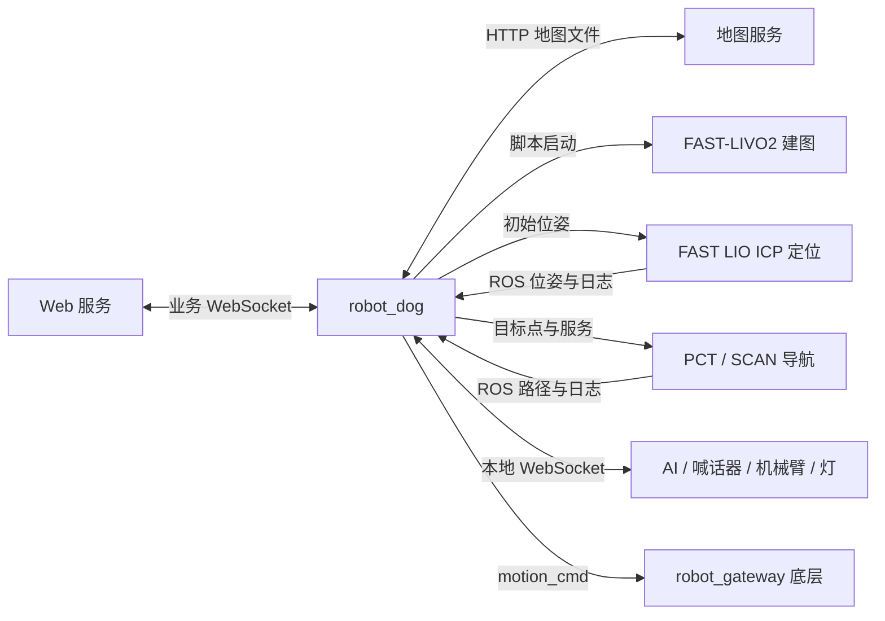
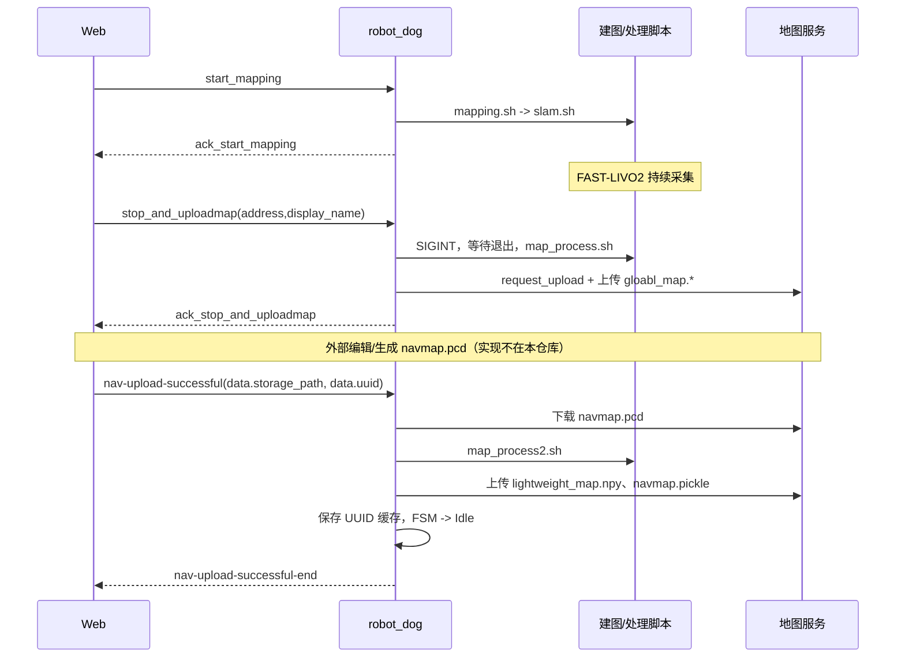
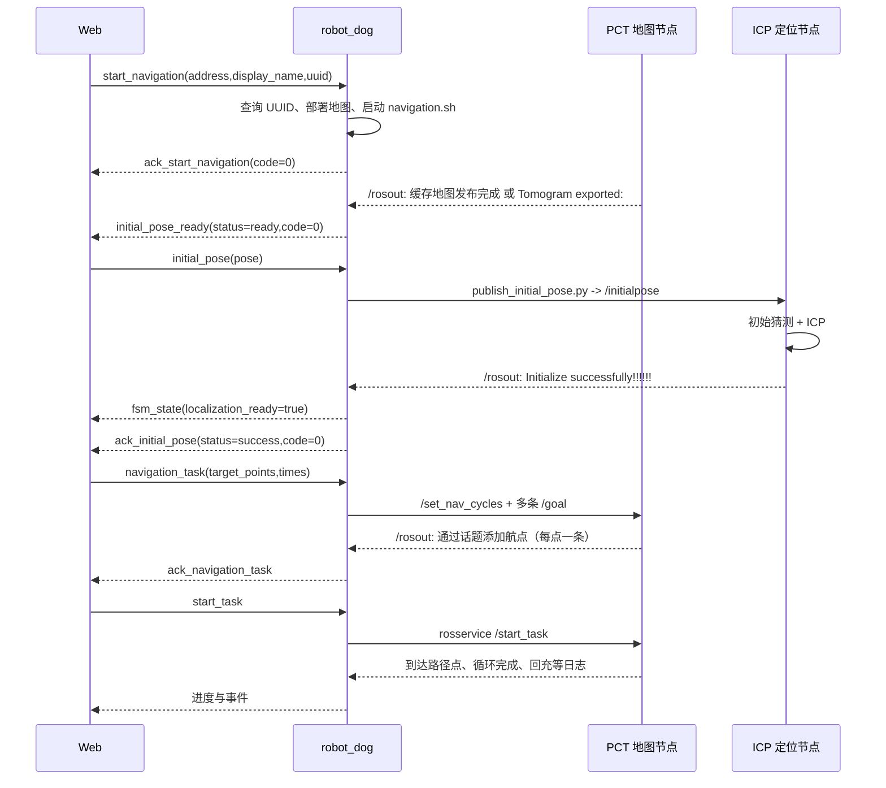
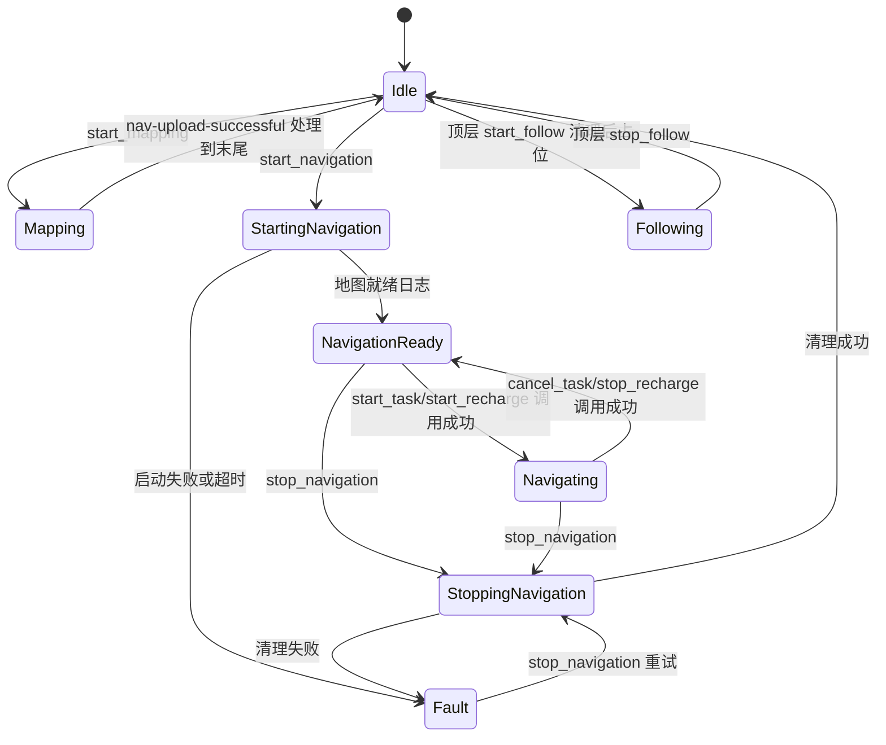

# 建图、重定位与导航流程

## 1. 系统职责

`robot_dog` 是 ROS Noetic/C++17 业务桥接程序，ROS 节点名 `/leggedog_gateway_node`。它连接 Web 服务，解析 JSON、协调 FSM、调用脚本和 ROS 服务、上传/下载地图、转发运控和设备消息、上报位置与状态。SLAM、ICP 重定位、路径规划和底层执行由项目外工作空间实现。

| 模块 | 源码 | 职责 |
| --- | --- | --- |
| 启动与组装 | `src/main.cc` | 读取配置、设备 ID、启动网关/本地 WS/BMS/灯光定时器 |
| 网络网关 | `src/gateway/gateway.cc` | WebSocket 连接、心跳、重连、去重、超时、设备消息转发 |
| 命令执行器 | `src/CommandExecutor.cc` | 命令路由、导航/定位确认、任务/回充/状态上报 |
| 行为 FSM | `include/RobotFsm.h`, `src/robotDto.h` | 模式互斥、任务状态、generation、取消过期请求 |
| 地图工作流 | `src/mapping/maphandle.cc` | 开始/停止建图、后处理、首轮上传 |
| 地图传输 | `include/manager.h`, `include/http_map_uploader.h` | HTTP 地图元数据、上传/下载、进度 |
| 运控 | `src/motionControl/motionHandle.cc` | Web 速度/姿态转 `/motion_cmd`，超时看门狗 |
| 状态与电池 | `src/robotState/robotState.cc`, `src/bms/BmsForwarder.cc` | 两种不同通道的状态上报、M20/A10 电池 |
| 外设 | `src/localWebsocket`, `src/aiRecognition`, `src/hikvision`, `src/broadcast`, `src/follow` | 本地设备 WS、AI 图片、云台、音频、HTTP 跟随 |
| 参数 | `src/modifyValue/modifyHandle.cc` | 修改本项目 XML/YAML 文件 |



## 2. 什么时候建图，什么时候重定位

**建图**：要创建一个新的场地地图时使用；例如首次进入区域，或需要重新采集环境。当前实现不会自动发现环境变化后建图，也没有增量更新已有地图的业务接口。由 Web 明确发送 `start_mapping` 触发，必须在 Idle 状态。

**重定位**：已经有地图，准备在该地图上导航时，先 `start_navigation` 加载地图环境，再在 `initial_pose_ready` 成功后发送 `initial_pose`，给出机器人在地图里的初始位置和朝向。每次重新启动导航环境都会清除网关定位成功标志。定位偏移后可重新发送 `initial_pose`；前提是当前导航环境已就绪且没有其他受管命令占用。

系统没有“定位质量掉到阈值后自动发送 initial_pose”的网关逻辑。算法在初始化后每秒尝试更新匹配，静止时会跳过；网关也没有根据数据过期或后续匹配失败自动撤销 FSM 定位成功状态的完整机制。

推荐人工重定位时机包括搬动机器人、切换地图、重启定位节点、发现地图与机器人位姿明显偏离；这些是操作建议，不是代码自动触发条件。

## 3. 建图完整时序



### 3.1 开始建图

输入：`{"type":"start_mapping","device_id":"M20-P1-bsy"}`。

1. FSM 只允许 Idle，进入 Mapping；受管命令锁防止并发。
2. 删除 `/home/jianmi/g_build_map/` 下的 `all_raw_points.pcd`、`gloabl_map.pcd`、`gloabl_map.pickle`。删除操作发生在建图 PID 重复检查之前。
3. 检查 `<scripts_path>/mapping.sh` 是否存在且可读，fork 独立进程组，执行脚本。
4. `mapping.sh` 切到 `/home/jianmi/catkin_pct/Scripts` 并执行 `slam.sh`。
5. `slam.sh` 加载 `/opt/ros/noetic`、`/home/jianmi/fast_wa/devel/setup.bash`，清空 FAST-LIVO2 的 `Log/PCD`，执行 `roslaunch fast_livo mapping_avia.launch`。
6. 父进程记录 PID，发 `ack_start_mapping`，`code=0,status=success`。这只证明 fork 成功，不验证子进程后续 exec、雷达输入或点云质量。

开始建图后由操作者遥控采集环境。代码没有自动探索路线或自动结束建图的判断。

### 3.2 停止、处理和第一轮上传

输入示例：

```json
{"type":"stop_and_uploadmap","device_id":"M20-P1-bsy","address":"site_A","display_name":"floor_3"}
```

1. 必须处于 Mapping；启动后台处理，重复结束请求有原子标志保护。
2. 对记录的建图进程组发 SIGINT，阻塞 `waitpid` 等待，之后再等 2 秒。此 waitpid 没有超时限制。
3. 执行 `map_process.sh`：清理 `g_build_map/PCD`，从 FAST-LIVO2 复制点云，运行 `merge_pcd_with_poses.py` 合并、`downsample_tool.py` 降采样、`only_tomograph.py` 构建地图。
4. 脚本返回 0 后，`POST /request_upload` 获取存储路径和 UUID，再顺序上传 `gloabl_map.pcd` 与 `gloabl_map.pickle`。项目中拼写就是 `gloabl`，不能自行改为 `global`。
5. `ack_stop_and_uploadmap` 返回 `storage_path`、`uuid`、`map_type=high`。`status=completed_and_uploaded` 表示传输层返回成功；`completed_but_upload_failed` 表示处理结束但上传失败。两种情况下 `code` 都是 0，客户端必须检查 status。
6. 此时 FSM **仍为 Mapping**，不能立刻 start_navigation，必须完成第二阶段。

没有建图 PID、脚本缺失、脚本失败等分支并不都有业务失败回包，可能只有日志。`map_process.sh` 未启用 `set -e`，末尾 echo 可能使脚本在中间命令失败时仍返回 0；不能只看退出码。

### 3.3 服务端地图加工后的第二阶段

输入示例：

```json
{"type":"nav-upload-successful","device_id":"M20-P1-bsy","data":{"storage_path":"site_A/floor_3/UUID","uuid":"UUID"}}
```

服务端如何从原始地图生成或编辑 `navmap.pcd` 不在本项目中，需由外部业务完成后通知。本命令不会自动替代服务端处理。

1. 清空 `map_dir`（默认 `/home/jianmi/g_nav_map`）内容。当前代码先清空再检查 storage_path。
2. 按 `/` 拆分 storage_path，前两段当作 address 和 display_name。因此应传相对路径 `address/display_name/uuid`，不能直接传服务器绝对路径。
3. 从 `g_build_map` 复制 `gloabl_map.pcd`、`gloabl_map.pickle` 到 `g_nav_map`。
4. 下载服务端 `navmap.pcd`，执行固定绝对路径 `/home/jianmi/catkin_pct/Scripts/map_process2.sh`。
5. 该脚本执行 `pcd_process.py` 与 `navmap_tomograph.py`，目标产物为 `lightweight_map.npy`、`navmap.pickle`。
6. 上传这两个产物，把 `gloabl_map.pcd`、`navmap.pcd`、`lightweight_map.npy`、`navmap.pickle` 复制到 `/home/jianmi/map_manager_local/<uuid>/`。
7. 发 `nav-upload-successful-end`（code=0），FSM 退出 Mapping 回 Idle，再发 `fsm_state`。

限制：本函数忽略下载与 upload_map_sh 的成功返回值；因此末尾回包不是服务端四个文件都完整可用的严格证明。建议使用文件存在性、大小及服务端结果复核。失败提前 return 时可能留在 Mapping，当前没有独立 `abort_mapping` 命令。

## 4. 导航环境启动与重定位时序



### 4.1 开启导航环境

输入：

```json
{"type":"start_navigation","device_id":"M20-P1-bsy","address":"site_A","display_name":"floor_3","uuid":"UUID"}
```

`uuid` 是客户端旧 UUID，用于与 `/get_uuid` 返回的新 UUID 比较，并不是不经校验直接选图。address 默认空，display_name 默认 `Unnamed Map`。缺少地图信息属于错误。

流程：Idle -> StartingNavigation；检查已有进程/内部标志；HTTP 查询新 UUID；先从 `/home/jianmi/map_manager_local/<新uuid>/` 复制 navmap.pcd/pickle 到 g_nav_map 和 PCT rsc；若旧 UUID 与新 UUID 不同，后台下载四种地图文件；启动 navigation.sh；等待环境日志。

**当前实现顺序有局限**：缓存复制发生在后台下载之前，所以即使理论上可以从服务端下载的新地图，若新 UUID 本地目录缺文件，也可能先因复制异常失败。后台下载完成后也没有重新执行前面的 PCT navmap 部署步骤，需复核文件版本。

实际 `navigation.sh` 启动：

| 次序 | 工作空间/命令 | 作用 |
| --- | --- | --- |
| 1 | `roslaunch fast_lio_localization localization_MID360.launch map:=/home/jianmi/g_nav_map/gloabl_map.pcd` | FAST LIO、全局 ICP、融合、地图发布 |
| 2 | `roslaunch pct_planner global_planner.launch` | 地图层、全局/局部规划、动作服务、任务管理、RViz |
| 3 | `roslaunch scan_planner run.launch` | SCAN 局部规划 |
| 4 | `rviz -d default.rviz` | SCAN 可视化 |

脚本里 Neupan/楼梯过滤等多行命令处于注释状态，不能按注释视为已启动。上层 C++ 还会加载 catkin_ws、catkin_livox、catkin_pct、fast_wa 和两个 GTSAM 库路径，详见脚本/源码索引。

### 4.2 判断“现在可以发重定位”

开始等待后 120 秒内，`/rosout.msg` 包含任一字符串即可判环境就绪：

```text
Tomogram exported:
缓存地图发布完成
```

网关要求存在本次 `navigation_env_pending_`，且处于导航相关模式。成功后返回 `initial_pose_ready`，`status=ready,code=0`，清除 localization_ready，FSM 变 NavigationReady。

若超时：`initial_pose_ready.status=failed,code=-1`，FSM Fault。**该回包的 message 在失败时仍固定写“重定位已准备就绪！！！”**，前端必须以 code/status 和 fsm_state 为准。

`ack_start_navigation.code=0` 是环境脚本已启动的中间回包，不能作为地图就绪或重定位成功。由于异步调度，不能要求中间回包和就绪回包绝对按固定先后到达。

### 4.3 初始位姿格式和下发

```json
{"type":"initial_pose","device_id":"M20-P1-bsy","pose":{"position":{"x":1.2,"y":3.4,"z":0.0},"orientation":{"x":0.0,"y":0.0,"z":0.0,"w":1.0}}}
```

pose 必须在顶层。位置单位米；orientation 是四元数 `(x,y,z,w)`，不要把 yaw 数字填到 quaternion.z。网关转为 roll/pitch/yaw，以 `x y z yaw pitch roll` 参数顺序调用 `publish_initial_pose.py`，该脚本重建四元数并发布 `/initialpose`，frame 为 map。欧拉角单位弧度。

字段默认值：position xyz=0，orientation xyz=0、w=1；实际缺少 pose/position/orientation 或类型不正确可能触发解析异常，不应依赖缺字段兼容。代码不校验四元数归一化。

下发依赖 `gnome-terminal`、桌面 DISPLAY/会话和 ROS 环境；网关不检查发布脚本是否真正成功运行，而是在后续 20 秒等待日志。

### 4.4 算法内部真正的匹配条件

依据：`/home/jianmi/fast_wa/src/FAST_LIO_LOCALIZATION/scripts/global_localization.py`。

| 项目 | 当前值/逻辑 |
| --- | --- |
| 初始化前提 | `/map` 点云、`/Odometry` 里程计、`/cloud_registered` 当前扫描 |
| 初始变换 | `T_map_to_odom = T_map_to_base_link * inverse(T_odom_to_base_link)` |
| 地图下采样 | 0.4 m |
| 扫描下采样 | 精匹配 0.1 m，粗匹配 0.3 m |
| 局部地图 | KDTree 按机器人预估位置取半径 30 m 内点，少于 100 点直接失败 |
| 粗 ICP | PointToPoint，最大对应距离 3.5 m，15 次迭代 |
| 精 ICP | PointToPoint，最大对应距离 1.5 m，20 次迭代 |
| 接受条件 | `res_fine.fitness > 0.9 && res_fine.inlier_rmse < 0.35`，严格大于/小于 |
| 成功结果 | 更新 T_map_to_odom，发 `/map_to_odom`，打印 `Initialize successfully!!!!!!` |
| 拒绝结果 | `Match Reject! Fitness: ..., RMSE: ...`；直接初始位姿接收分支另见下面 |
| 持续更新 | 初始化后 1 Hz，二维位移 <0.03 m 且四元数绝对点积 >0.999 时跳过 |

算法打印 `--- ICP Result ---`、`Time Cost: ... s`、`Fitness Score: ... (Threshold: 0.9)`。成功分支没有启用 RMSE 单独打印，只有拒绝日志同时显示 fitness/RMSE。不能只凭 fitness 大于 0.9 就判断满足复合条件。

`cb_initial_pose` 中 ICP 不通过时，算法仍设 `initialized=True`，直接接受给定初始位姿，打印：

```text
ICP refinement warning, but Initial Pose accepted directly.
Relocalize successfully!!!!!!
```

这不是网关采用的成功字符串。该分支也没有像 ICP 成功分支那样立即发布 `/map_to_odom`，可能要等后续周期匹配真正成功才更新融合输入，因此“接受了初始值”也不等于融合输出已被正确修正。

### 4.5 网关如何确认本次重定位成功

`src/CommandExecutor.cc:1541` 的 `/rosout` 回调最后一段使用字符串包含匹配：

```cpp
if (msg->msg.find("Initialize successfully!!!!!!") == std::string::npos) return;
// 还需 initial_pose_pending_ 为 true，读取当前 attempt_id
complete_initial_pose_result(attempt_id, true, "Initialize successfully!!!!!!");
```

成功后执行：upload_enable=true、内部 localization_ready=true、FSM localization_ready=true；发 `fsm_state`，再发 `ack_initial_pose`（code=0,status=success），释放 initial_pose 的受管命令锁。

20 秒内没有匹配：`ack_initial_pose.code=1,status=failed,message="Timeout waiting for Initialize successfully!!!!!!"`，定位标志与上报开关设 false。可核对环境后重新发送 initial_pose。

边界：只匹配 msg 文本，不检查日志 level/name/file，也没有把日志绑定到真正的算法请求 ID。attempt_id 用来挡住旧超时线程，但不能识别“上一次算法操作迟到的同文本日志”。只应以网关当前请求对应的回包作为业务依据。

### 4.6 为什么有 /localization 还不能说重定位成功

`transform_fusion.py` 在没有收到 `/map_to_odom` 时使用单位矩阵，只要有 `/Odometry` 就会以 50 Hz 发布 `/localization`。因此尚未成功地图匹配也可能持续有输出。

网关 `localization_callback` 每次收到里程计都会把**内部原子变量** localization_ready 设为 true，并按频率发 upload_position，但不会把 FSM 的定位标志设为 true。`start_task` 检查的是 FSM 标志，因此位置有上报不保证允许启动任务。该回调也没有检查 upload_enable，重定位超时后仍可能继续上报位置。

## 5. 导航目标点与执行

目标点下发示例：

```json
{"type":"navigation_task","device_id":"M20-P1-bsy","task_id":"task_001","map_id":"map_001","uuid":"UUID","frame_id":"map","times":1,"target_points":[{"x":1.0,"y":2.0,"z":0.0,"wait_time":3.0,"orientation":{"x":0.0,"y":0.0,"z":0.0,"w":1.0}}]}
```

1. 导航环境就绪即可下发点，不要求 FSM 已定位成功；但 `start_task` 和 `start_recharge` 要求已定位成功。
2. 发布 `/set_nav_cycles`，times 小于 1 时改为 1；等 0.05 秒，然后逐点发 `/goal`。
3. **`PoseStamped.header.stamp` 被借用为 wait_time（秒），不是发送时间**；下游 taskRvizServer 使用这一约定。
4. 每条 `/rosout` 包含“通过话题添加航点”就增加确认计数；达到输入数组长度才回 `ack_navigation_task` 成功，否则 10 秒超时失败。
5. 成功下发点不自动走动；再发 `start_task` 调 `/start_task`。
6. 服务进程退出码为 0 时 FSM 置 Running。当前未解析 TriggerResponse.success，因此服务业务拒绝但 CLI 正常退出也可能显示调用成功。
7. “到达路径点/到达任务点/达到路径点/达到任务点”后第一串正整数生成 navigation_waypoint_reached。重复或不递增点号被忽略；上报可附 reached_points/total_points/progress。
8. 循环完成日志生成 navigation_task_state.task_round_completed；网关没有把循环完成或任务末点到达统一转成 FSM Succeeded 的逻辑，不能只看 FSM Running 判断是否仍在移动。

多轮任务点号从 1 重新开始时，当前“必须大于已到达点号”的去重逻辑可能抑制后续轮次点到达事件。round 事件和单点事件应分别使用。

暂停/恢复由 pause_task/resume_task 请求队列转换为 `/toggle_task_state_service`，相同目标状态幂等返回；日志进一步通知 task_paused/task_resumed。clear_waypoints 需要“所有航点已清除”日志确认；cancel_task 只取消任务，不停止整个导航环境。

## 6. 回充流程

先用 set_dock_pose 发布地图坐标下充电桩位姿，再 start_recharge 调服务。任务可中断、去桩、等待、充电、结束回充、回中断点继续；具体事件与全部日志匹配表见接口文档。`arrived_dock` 只代表到达桩位姿，不能单独证明充电电流已建立。BMS 的 charge_state/电流需另行核对。

stop_recharge 服务调用成功时，网关将任务状态设 Cancelled，而下游日志“已回到中断点，继续执行后续航点。”只生成回充事件，不同步纠正 FSM Running。这是当前状态一致性限制。

## 7. 模式互斥和取消

| 命令 | 准入条件 |
| --- | --- |
| start_navigation / start_mapping | Idle；FSM 健康若明确 UnHealthy 则拒绝 |
| stop_and_uploadmap / nav-upload-successful | Mapping |
| initial_pose / navigation_task / clear_waypoints / pause_task / resume_task / set_dock_pose | 导航相关模式且 navigation_environment_ready=true |
| start_task / start_recharge | 上述条件且 FSM localization_ready=true |
| cancel_task / stop_recharge | 导航相关模式；环境未就绪也允许 |
| stop_navigation | Idle、导航相关模式或 Fault 可进入清理；Mapping、Following、StoppingNavigation、StartingFollow 拒绝 |
| 顶层 start_follow | 可抢占 Idle/导航模式；Mapping、Stopping、StartingFollow、Fault 拒绝；已 Following 幂等 |
| 顶层 stop_follow | 仅 Following |
| get_fsm_state | 任意状态，只查询 |
| action_control / control / follow / 外设 / set_param | 不经过此行为互斥准入 |

受管命令：initial_pose、start_navigation、navigation_task、stop_navigation、start_mapping、stop_and_uploadmap、nav-upload-successful、start_task、clear_waypoints、cancel_task，以及仅在管理列表中出现的 start_add_task/start_add_point/stop_add_point/stop_add_task。busy 返回 code=409、active_command。stop_navigation 走提前分支，绕过 busy 门禁，递增 generation、作废各类 pending/超时和排队任务，再清理进程。

正常停止：进程组 SIGINT，短暂等待后必要时 SIGKILL；运行 kill_all.sh 与残留清理；检查导航进程是否仍在。成功发 ack_stop_navigation，FSM Idle；失败 FSM Fault，可再 stop_navigation 重试。

顶层 start_follow/stop_follow 是 **FSM 占位接口**，不会向跟随硬件发送命令；独立的 `type=follow,cmd=start_follow` 则实际调 HTTP 后端，两者不是同一条执行链，HTTP 跟随绕过 FSM。health 当前保持 Unknown，跟随占位状态不能证明硬件在跟随。

`fsm_state` 对外字符串枚举：motion_mode 为 Idle、StartingNavigation、NavigationReady、Navigating、StartingFollow、Following、Mapping、StoppingNavigation、Fault；task_status 为 Idle、Starting、Running、Paused、Stopping、Succeeded、Cancelled、Failed；health 为 Unknown、Healthy、UnHealthy。源码内部 MotionMode::Stopping/Failed 分别输出 StoppingNavigation/Fault，TaskStatus::Successed 输出 Succeeded；内部拼写不能直接当作 Web 协议值。

模式迁移概览：



Navigating 内部还区分 Running/Paused；图中的 Following 省略了 StoppingNavigation/StartingFollow 中间步骤。运控指令独立发布，FSM 不提供对所有物理运动来源的独占控制。
